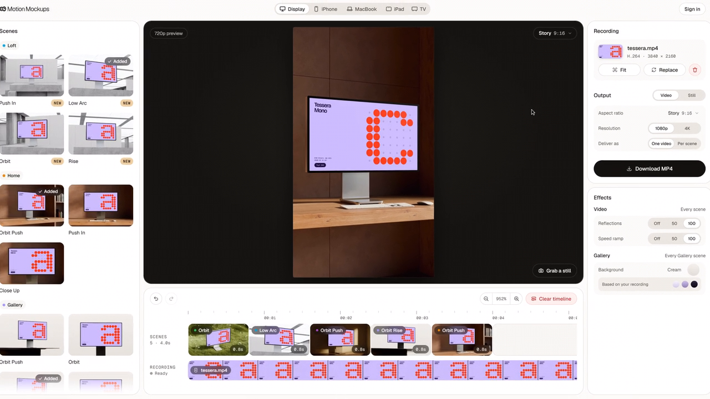

# Hi, I'm Krystof

I'm a CGI designer in Prague. Most of my work is 3D, motion and art direction, and I build the tools I wish I had, usually somewhere around rendering, WebGL or video.

## Now building: Motion Mockups

**[Motion Mockups](https://motionmockups.com/?utm_source=github&utm_medium=profile)** makes mockup videos in art-directed environments, in minutes, in your browser. You drop in a screen recording and it plays on an iPhone, iPad, MacBook, display or TV inside 3D rooms I model, light and render myself. The camera and light are already set, so there are no keyframes to touch: pick scenes, cut them into one film and export an MP4. Live since October 29, 2026.

How it's made:

- **Blender (Cycles)** for the rooms: every scene is rendered ahead of time, with its camera and screen geometry exported for the browser.
- **TypeScript and Three.js** for the editor: your recording is placed on the device's screen live, frame by frame, following the scene's own camera.
- **WebCodecs and [Mediabunny](https://github.com/Vanilagy/mediabunny)** to decode and encode video in the browser, with frame-accurate export to H.264 MP4.
- **Vite, Vercel, Cloudflare R2, Supabase and Stripe** around it.

It grew out of my bachelor's thesis (below), which automated video mockups with Python and OpenCV on a server. Motion Mockups does the same job in the browser.

[Try it](https://motionmockups.com/?utm_source=github&utm_medium=profile) · [Launch film](https://youtu.be/9Pc_X5UUKbI)

## Other things I've made

### [Threadlab](https://github.com/krysjezek/embroidery-generator)

Turns artwork into an editable embroidered PBR material in the browser: colour separation, stitch fields, baked texture maps and a live Three.js preview. [Live app](https://embroidery-generator-production.up.railway.app)

### [Normal Map Generator](https://github.com/krysjezek/generate-normal-maps)

A WebGL2 tool for turning heightmaps into normal maps in the browser, with a lit preview, OpenGL and DirectX output and full-resolution export. [Live app](https://generate-normal-maps-production.up.railway.app/)

### [Handheld Loop](https://github.com/krysjezek/blender-handheld-loop) and [Smart Clay](https://github.com/krysjezek/blender-smart-clay)

Two Blender extensions I use in my own work. Handheld Loop adds procedural, perfectly looping camera shake without touching your animation. Smart Clay switches a scene to one adjustable clay look and restores every material with one click.

### [Prague Airspace](https://github.com/krysjezek/prague-airspace)

A small Node.js collector for live air traffic around Prague and airport weather, feeding the widgets on my portfolio. No dependencies, no API keys.

### [Video Processing Backend](https://github.com/krysjezek/video-process-backend)

My bachelor's thesis at FEE CTU, where I studied Software Engineering: Python, OpenCV and MoviePy automating video mockup processing. The first version of the idea behind Motion Mockups.

## Stuff I use

- **3D and motion:** Blender, After Effects, product visualization, FOOH and mixed reality
- **Web:** TypeScript, Three.js, WebGL, WebCodecs, React and Next.js
- **Other:** Python, C++, OpenCV and MoviePy

## Links

[Motion Mockups](https://motionmockups.com/?utm_source=github&utm_medium=profile) · [Portfolio](https://www.krystofjezek.com/) · [YouTube](https://www.youtube.com/@krystofjezek) · [X](https://x.com/krysjezek) · [Instagram](https://www.instagram.com/krystof.jezek/) · [LinkedIn](https://www.linkedin.com/in/krystofjezek/)
